# Project Report — Automated Tile Inspection, Grading and Sorting System

> **Working draft for Review 2.** Status date: **2026-10-12**. Template: *2026 Template for Capstone
> Project 1 Report (BMH)* in this folder. Rubric: `Review_2_Evaluation_Form.md`.

---

## 0. Authoring notes (delete this whole section before printing)

### 0.1 Keeping this report current — standing rule

**This report is a living document. Whenever work happens that changes what is true here, this file
and its figures are updated in the same commit as the work.** Concretely:

| When this happens | Update here |
|---|---|
| A feature is built, a decision is made or reversed | The matching chapter 4 subsection, the Figure 4.x diagram (edit `figures/make_figures.py`, re-run it), the readiness matrix (Fig. 5.1) |
| A new measurement or test is made (accuracy, timing, rig run, labelled batch) | Chapter 5 table + chart; update the numbers in the abstract and conclusion |
| A bug, wrong assumption or hardware surprise is found | Chapter 5 §5.6 (faults) and Chapter 6 §6.3; keep the failed attempt in the text, do not erase it |
| Hardware arrives or a part is bought | Chapter 4 equipment table, Chapter 5 cost table (real price, with invoice reference) |
| A paper is read and used | Chapter 2 + References (read it first; never cite from a search snippet) |
| Something claimed "not yet run" gets run | Move it from "not verified" to "verified" in §5.1 **with the date and the evidence file** |

Housekeeping rules that apply every time:

1. **Every number has a source** — a file in the repo or a dated measurement. If it cannot be traced, it does not go in.
2. **Say what was *not* verified.** The status table in §5.1 is the single source of truth for "does it work".
3. **Figures are generated, not pasted.** Add or change them in `figures/make_figures.py`; numbers on charts are read from
   project files or sit in its DATA block with the source named.
4. **Synthetic signals are labelled synthetic** on the figure itself.
5. Update the **"Status date"** at the top and the open-items list (§0.3).
6. Add a line to `../logbook/Logbook.md` (the guide-signed record) for the same session.

The same rule is recorded in `.CLAUDE/CLAUDE.md` (Development Rules, rule 6) so it applies in every session.

### 0.2 How this draft maps to the Review 2 rubric (Level 5 targets)

| Criterion | What Level 5 needs | Where this report addresses it | Honest gap |
|---|---|---|---|
| 1. Technical depth & domain knowledge | Expert-level understanding *and justification* | Ch.4 (methods with equations and reasons for each choice), §5.6 (faults found and why), App. A | Literature list is short of the 20 recent journal papers the template asks for |
| 2. Demonstration & system performance | "Optimized, industry-ready" | §5.1 status matrix, §5.2–5.5 measured results, demo plan §0.4 | **Not industry-ready and cannot be claimed so.** Nothing has run on the Pi, the tap rig or the gantry. Level 3–4 ("functional", "stable") is the defensible target; the report is built to defend that honestly |
| 3. Innovation & originality | Highly innovative | §5.7 (what is new, what is not) | Of the two novelty items proposed after Review 1, LLM diagnosis is built (laptop-only, synthetic data, §5.7); adaptive grading is **not built** and is reported as future work |
| 4. Question handling & defence | Excellent analytical defence | §5.6 faults, §6.3 hurdles, §0.5 likely questions | Needs rehearsal, not text |
| 5. Societal, industrial & future scope | Strong relevance with scalability | §2.7, §3.3, §5.8, §6.2 | No measured saving; no SMTW tile size/throughput data yet |

### 0.3 Open items before this can be submitted

1. **Literature.** The template requires ≥ 20 recent journal papers and 600–1000 words. This draft has **7 recent journal /
   conference papers with verified details**, the rest are foundational methods. The team must read and add more (leads in §2.9).
2. **Costed bill of materials.** Component list exists (Table 5.6); **prices are blank** — fill from invoices/quotes.
3. **SMTW data**: tile size range, weight, daily volume, current reject rate and labour cost. None obtained.
4. **Individual contributions** (§1.5): the guidelines require each student's own contribution. Placeholders only.
5. **Rewrite in the team's own words.** The college rule is *no plagiarised or AI-generated content*. This draft was assembled
   with an AI assistant from the project's own records; it must be rewritten and owned by each student before it is printed.
   Facts, numbers and figures may stay; sentences should not.
6. **Plagiarism report** (Appendix B), guide signature, examiner/HOD signatures, 5 printed copies, VTOP PDF.
7. **Sustainability goal** (§3.3) is a proposal — confirm with the guide.
8. Re-run `figures/make_figures.py` after any data change; check Figs. 5.3–5.5 still match the dataset.

### 0.4 What to demonstrate on the day (suggestion)

Only things that really run: (a) camera dashboard on the laptop webcam *or* a recorded belt video — tiles counted, graded,
trigger line, per-stage times; (b) the station GUI in `--demo` mode (state clearly that the microphone and camera are
synthetic); (c) the pick-and-place twin; (d) the review sheet / label workflow and the confusion matrix (§5.3).
Do **not** show anything as "the tap test works" — no real tile has been tapped on the rig.

### 0.5 Questions a reviewer is likely to ask

- *Why classical image processing and not just a neural network?* — §4.4.3, Fig. 5.7 (model cannot see cracks, 30 % confidence on this camera).
- *How do you know it works?* — §5.3: 88 human-labelled tiles, with the misses shown. Small, one rig.
- *Why is the acoustic result not used in the grade?* — §4.6: no validated reference; it is recorded but not counted by design.
- *What happens when something fails?* — Fig. 4.5 and the fail-closed table.
- *Why a ball drop and not a hammer?* — §4.5.
- *Will it work on the real factory floor?* — not shown; §6.3 lists exactly what is untested.

---
---

<div align="center">

# AUTOMATED TILE INSPECTION, GRADING AND SORTING SYSTEM

*(working title — use the title on the Review 0 / Review 1 forms: "Automated Tiles Sorting and Packing System")*

Project report submitted in partial fulfilment of the requirements for the degree of

**Bachelor of Technology in Mechatronics and Automation Engineering**

by

**MITHUNVEL KL (23BMH1029)**
**KANIGALPULA TEJA PAVAN SAI ADINARAYANA GUPTA (23BMH1007)**
**MADHUMITHA VEMULA (23BMH1019)**

Guide: **Dr. Jegadeeshwaran R** (Faculty ID 50204)

**SCHOOL OF MECHANICAL ENGINEERING**
**VELLORE INSTITUTE OF TECHNOLOGY, CHENNAI**

October, 2026

</div>

---

## DECLARATION

We, **Mithunvel KL (23BMH1029), Kanigalpula Teja Pavan Sai Adinarayana Gupta (23BMH1007) and Madhumitha Vemula
(23BMH1019)**, B.Tech. Mechatronics and Automation Engineering, VIT Chennai, hereby declare that the work presented in
the dissertation entitled **"AUTOMATED TILE INSPECTION, GRADING AND SORTING SYSTEM"** is an authentic record of the work
that has been carried out at VIT Chennai under the guidance of **Dr. Jegadeeshwaran R**, School of Mechanical
Engineering, VIT Chennai.

We hereby declare that the entire work embodied in this dissertation has been carried out by us and no part of it has
been submitted for any degree or diploma of any institution previously.

Place: Chennai          Date:

Mithunvel KL (23BMH1029): ______________   Kanigalpula Teja Pavan Sai Adinarayana Gupta (23BMH1007): ______________
Madhumitha Vemula (23BMH1019): ______________

---

## CERTIFICATE

This is to certify that the project report entitled **"AUTOMATED TILE INSPECTION, GRADING AND SORTING SYSTEM"**
submitted by **Mithunvel KL (23BMH1029), Kanigalpula Teja Pavan Sai Adinarayana Gupta (23BMH1007) and Madhumitha
Vemula (23BMH1019)**, for the award of the degree of Bachelor of Technology, is a record of bonafide work carried out by
them under my supervision, as per the VIT code of academic and research ethics.

The contents of this report have not been submitted and will not be submitted either in part or in full, for the award of
any other degree or diploma in this institute or any other institute or university. The report fulfils the requirements
and regulations of VIT and in my opinion meets the necessary standards for submission.

Signature of the Guide: ______________  Name: Dr. Jegadeeshwaran R  Date:

Signature of Examiner-1: ______________  Name:  Date:        Signature of Examiner-2: ______________  Name:  Date:

Approved by Head of the Department

---

## ABSTRACT

Sree Murugan Tile Works (SMTW), a clay tile manufacturer, inspects, grades, sorts and packs its tiles entirely by hand.
Manual grading varies between operators, tires, cannot see internal cracks and leaves no traceable record. This project
designs and partly builds an automated line that inspects each tile by camera, by the sound of a controlled tap and (as
planned) by dimensional measurement, fuses the results into one grade, and routes the tile with a Cartesian pick-and-place
gantry. The camera station was built first and run on a laptop webcam and five belt videos containing 92 tiles. It finds
tiles only on the belt, tracks each tile separately, grades it once as it crosses an automatic trigger line, and measures
cracks and corner damage from the outline and edge map. A Raspberry Pi 5 decision service binds each tap to the correct
tile, takes the worse of the camera and sound grades, fails closed to a manual-bin "Hold", and delivers the final grade to
the gantry controller over MQTT. Against 88 tiles labelled by eye, the camera check rejected 14 of 30 damaged tiles and 4
of 58 good ones; the crack check is the weak link and is being recalibrated. 734 automated tests pass. The acoustic
rig, the Pi deployment and the gantry firmware have not yet run on hardware, and this report states that plainly.

**Keywords:** tile inspection, machine vision, impact-acoustic testing, sensor fusion, pick-and-place.

---

## ACKNOWLEDGEMENT

It is our pleasure to express with deep sense of gratitude to **Dr. Jegadeeshwaran R, <Designation>**, School of
Mechanical Engineering, Vellore Institute of Technology, Chennai, for his constant guidance, continual encouragement and
understanding. We are grateful to the management of Sree Murugan Tile Works for the problem and the tile samples.

We extend our thanks to the visionary leader Dr. G. Viswanathan, our Honourable Chancellor; Mr. Sankar Viswanathan,
Dr. Sekar Viswanathan and Dr. G. V. Selvam, Vice Presidents; Dr. Sandhya Pentareddy, Executive Director; Ms. Kadhambari
S. Viswanathan, Assistant Vice-President; Dr. V. S. Kanchana Bhaaskaran, Vice-Chancellor; Dr. T. Thyagarajan, Pro-Vice
Chancellor, VIT Chennai; and Dr. P. K. Manoharan, Additional Registrar, for providing an exceptional working environment.

We thank Dr. Karunamurthy K., Dean of the School of Mechanical Engineering, Dr. Saravanakumar D., Head of the Department,
B.Tech. Mechatronics and Automation Engineering, and the Project Coordinators for their valuable support, and all the
faculty and staff of VIT Chennai who helped us acquire the requisite knowledge. We thank our parents and friends for
their support.

Place: Chennai          Date:

Mithunvel KL (23BMH1029) · Kanigalpula Teja Pavan Sai Adinarayana Gupta (23BMH1007) · Madhumitha Vemula (23BMH1019)

---

## TABLE OF CONTENTS

| | Page |
|---|---|
| Declaration · Certificate · Abstract · Acknowledgement | i–iv |
| List of Figures · List of Tables · Nomenclature · Acronyms | v–viii |
| **Chapter 1  Introduction** — 1.1 Background · 1.2 The problem · 1.3 The proposed solution · 1.4 Scope · 1.5 Contribution of each student | 1 |
| **Chapter 2  Review of Literature** — 2.1 Visual inspection of tiles · 2.2 Acoustic inspection · 2.3 Sensor fusion · 2.4 Sorting and handling · 2.5 Edge hardware and models · 2.6 Gap · 2.7 Societal and industrial significance · 2.8 Alternatives, cost and feasibility · 2.9 Open reading list | |
| **Chapter 3  Problem Definition and Objectives** — 3.1 Problem definition · 3.2 Objectives · 3.3 Sustainability goal | |
| **Chapter 4  Methodology** — 4.1 Development method · 4.2 System architecture · 4.3 Materials and equipment · 4.4 Camera station · 4.5 Acoustic station · 4.6 Decision and fusion · 4.7 Pick and place · 4.8 Verification method | |
| **Chapter 5  Results and Discussion** — 5.1 Status · 5.2 Pipeline behaviour · 5.3 Accuracy against human labels · 5.4 Image quality · 5.5 Models · 5.6 Faults found and fixed · 5.7 Innovation and technical depth · 5.8 Cost-benefit, environment and society | |
| **Chapter 6  Conclusion** — 6.1 Achievements · 6.2 Scalability · 6.3 Technical hurdles · 6.4 Future work | |
| References · Appendix A (design data and code) · Appendix B (plagiarism report) | |

*(Page numbers are added when the document is typeset in the college template. "List of publication" is omitted — blank.)*

## LIST OF FIGURES

| No. | Title |
|---|---|
| 4.1 | Method followed, from problem study to pilot |
| 4.2 | System architecture: nodes, network and physical line |
| 4.3 | Camera pipeline |
| 4.4 | Grade fusion |
| 4.5 | Per-tile decision flow with fail-closed branches |
| 4.6 | Message sequence for one tile |
| 4.7 | Tap sequencer state machine |
| 4.8 | Synthetic tap signals and the measured features |
| 5.1 | Readiness matrix |
| 5.2 | One real frame: belt region, tile contour, trigger line |
| 5.3 | Pipeline grades per video and human verdicts |
| 5.4 | Pipeline decision against human verdict |
| 5.5 | Real tiles and what the pipeline decided |
| 5.6 | Motion smear against exposure time |
| 5.7 | Cost of each tile-grade model |
| 5.8 | Corner-check operating point trade-off |
| 5.9 | Development timeline |
| 5.10 | Test-suite growth |
| 5.11 | AI insights: Reject rate has risen |
| 5.12 | AI insights: More tiles are being held for a person |
| 5.13 | AI insights: More tiles are timing out without a tap |
| 5.14 | AI insights: Camera and sound disagree more than before |
| 5.15 | AI insights: Tiles take longer from camera to final grade |
| 5.16 | AI insights: Fewer tiles are coming through |
| 5.17 | AI insights: Alarm 'camera_silent' keeps repeating |

## LIST OF TABLES

| No. | Title |
|---|---|
| 1.1 | Individual contribution |
| 2.1 | Literature summary |
| 2.2 | Alternative technologies considered |
| 3.1 | Objectives and how each is measured |
| 4.1 | Hardware and equipment |
| 4.2 | Software stack |
| 4.3 | Camera configuration values that matter |
| 4.4 | Fail-closed rules |
| 4.5 | MQTT topics |
| 5.1 | Status of each part |
| 5.2 | Real belt footage processed |
| 5.3 | Decision against human verdict |
| 5.4 | Per-stage cost of the camera pipeline |
| 5.5 | Model accuracy and cost |
| 5.6 | Prototype bill of materials (prices to be entered) |
| 5.7 | Faults found and how they were fixed |

## LIST OF NOMENCLATURE

| Symbol | Meaning |
|---|---|
| $A_c$, $A_r$ | Area of the tile contour; area of its minimum-area bounding rectangle (px²) |
| $\rho$ | Fill ratio $A_c/A_r$ |
| $s$ | Side length of the tile in the image (px) |
| $d_{max}$ | Deepest point of the gap between contour and ideal rectangle (px) |
| $e$ | Missing-extent fraction $d_{max}/s$ |
| $a$ | Aspect ratio of the bounding rectangle, $\max(w,h)/\min(w,h)$ |
| $v$ | Belt speed in the image (px s⁻¹) |
| $t_{exp}$ | Exposure time (s) |
| $b$ | Motion smear $v\,t_{exp}$ (px) |
| $f_p$ | Dominant (peak) frequency of a tap (Hz) |
| $T_{20}$ | Time for the decay curve to fall 20 dB (s) |
| $G$ | Grade, ordered A < B < C < Reject |

## LIST OF ACRONYMS AND KEYWORDS

| Acronym | Meaning |
|---|---|
| ROI | Region of interest (here: the belt) |
| HSV | Hue–saturation–value colour space |
| FSM | Finite-state machine |
| ToF | Time-of-flight distance sensor |
| MCU | Microcontroller unit |
| MQTT | Message Queuing Telemetry Transport |
| QoS | Quality of service (MQTT delivery level) |
| ONNX | Open Neural Network Exchange (model file format) |
| CNN / ViT | Convolutional neural network / Vision Transformer |
| FFT | Fast Fourier transform |
| SNR | Signal-to-noise ratio |
| CI | Confidence interval |
| FR / NFR | Functional / non-functional requirement |
| SMTW | Sree Murugan Tile Works |
| SDG | UN Sustainable Development Goal |

**Keywords:** tile inspection · machine vision · impact-acoustic testing · sensor fusion · fail-closed control ·
Cartesian gantry · edge inference · MQTT.

---
---

# CHAPTER 1 — INTRODUCTION

## 1.1 Background

Fired clay and terracotta tiles are graded before sale. In most small and medium works this is still done by people
standing at a table, looking at each tile, tapping it, and sorting it into grades. The grade decides the price, so a
wrong decision either ships a defective tile (a returned order and a damaged name) or scraps a good one (a direct loss).
Three kinds of defect matter: *visible* ones — cracks, chipped or broken corners, outline distortion; *hidden* ones —
internal cracks and weak bonding that only show up in how the tile *sounds* when struck; and *dimensional* ones — size
and squareness drifting because kiln firing shrinks the corners and the centre unequally.

Machine vision for ceramic surfaces is an active research area, and impact-sound classification of tiles has been
reported in laboratory settings (Chapter 2). Low-cost edge computers (a Raspberry Pi 5 with 16 GB of RAM), small
microcontrollers and open message protocols (MQTT) now make it possible to build such a line from commodity parts.

## 1.2 The problem

The target works, Sree Murugan Tile Works (SMTW), performs inspection, grading, sorting and packing entirely by hand.
Human judgement varies from operator to operator and across a shift; repetitive inspection causes fatigue; internal cracks
cannot be seen; no per-tile record is kept; and sorting and packing after inspection are labour-intensive in themselves.
Published work usually solves one slice (a camera classifier *or* a tap-sound classifier) in isolation, reports accuracy
on a curated dataset, and does not address what a line must do when a station is late, a message is lost or a tile is
missed. Nobody downstream can use a grade that arrives without a trustworthy tile identity.

## 1.3 The proposed solution

A line in which every tile is inspected by three independent methods — camera, controlled-impact acoustics, and
dimensional measurement — each on its own compute node and each sending only a compact result. A Raspberry Pi 5 binds
the results to the right tile, computes one final grade, and forwards it to the pick-and-place controller, which places
the tile in its bin (Figure 4.2).

What is different from the usual single-method study:

1. **The system is the contribution, not one classifier.** Tile identity, ordering, timeouts and fail-safe behaviour are
   designed and tested alongside the measurement itself.
2. **Fail-closed by construction.** Any doubt — a missing tap, a lost message, an unreadable result — sends the tile to a
   manual "Hold" bin instead of guessing a grade.
3. **Measurement over classification.** Cracks and chips are *measured* (length, missing area, depth, in inches via the
   tile's own known size) rather than only labelled, so a threshold can be moved with evidence.
4. **A human-label loop.** Tooling lets a person label the borderline tiles and feeds that back to threshold advice, so
   calibration comes from the line's own footage and not from guesses.
5. **A non-contact, repeatable impact** (a gravity-dropped ball released by two solenoids) replacing a striker that touches
   the tile.

Honest scope of this report: items 1–4 are built and tested on a laptop; the acoustic rig (item 5), the Pi deployment and
the gantry are designed and partly coded but **have not run on hardware** (Table 5.1).

## 1.4 Scope

| In scope of this report | Not in scope / not done |
|---|---|
| Camera station: built, run on real belt footage | Dimensional station (design only; camera-based option kept open) |
| Station decision service (ledger, fusion, MQTT, GUI) on the laptop | Pi deployment — no Pi has been set up |
| Acoustic analysis app and tap-sequencer logic | Acoustic rig on real tiles — not run |
| Pick-and-place protocol, coordinate model, twin | Gantry firmware and motion on real axes |
| Tile size assumed 9 × 9 in (sample tiles) | SMTW's real size/weight range — not yet obtained |

## 1.5 Contribution of each student

> **To be completed by the team.** The college guidelines require each student's personal contribution to be stated.
> The repository's history shows what was built, but not who did it; do not infer this from commits.

| Student | Register no. | Personal contribution |
|---|---|---|
| Mithunvel KL | 23BMH1029 | *(fill in)* |
| Kanigalpula Teja Pavan Sai Adinarayana Gupta | 23BMH1007 | *(fill in)* |
| Madhumitha Vemula | 23BMH1019 | *(fill in)* |

*Table 1.1 — Individual contribution*

---

# CHAPTER 2 — REVIEW OF LITERATURE

> Word target 600–1000, ≥ 20 recent journal papers. **Only sources whose details were checked are listed with full
> citations.** Items marked † still need their bibliographic details confirmed from the publisher page before submission.

## 2.1 Visual inspection of ceramic tiles

Deep-learning surface-defect detection is now the dominant approach for ceramic and tile inspection. A recent review of
ceramic surface-defect detection with deep learning [4] organises the field around data preparation, imbalanced and
small-sample problems, small-target detection and lightweight real-time models; an earlier review [7] summarises
YOLOv5-based workflows. Lightweight YOLO variants are reported for tile defects — CTDD-YOLO† [6] for tiny flaws and
MCAW-YOLO† [5] — and a comparison of YOLOv8 to YOLOv11 for ceramic **crack** detection [3] concludes that YOLOv8 is the
most practical for resource-constrained deployment, on a dataset of only about 300 images. A transfer-learning study on
ceramic tiles and a PCA + neural-network classifier (reported 90.1 % accuracy at about 0.5 s per snapshot) also appear in
the literature (leads only — to be read and cited, §2.9). The common pattern is a curated, single-surface dataset, high headline accuracy, and no discussion of the
motion blur, belt tracking or lighting of a running line.

**Classical image processing remains relevant** where a *measurement* is needed rather than a class: Canny edge detection
[12], contour following [13] and distance transforms [14] give crack length and missing-area directly, with no training
set, and are the basis of the camera station here.

## 2.2 Acoustic (tap-sound) inspection

Tapping is how people find hollow or cracked tiles by ear. Automating it has been studied for *bonding quality* of
installed tiles — impact-acoustic testing of tile walls with wavelet and support-vector-machine classification [8, 9] —
and for **tile quality** in factory conditions. Panyavaraporn et al. [1] classify dull versus hollow tapping sounds with
DWT/MFCC features and a CNN and report up to 93.67 % in the laboratory. Cunha et al. [2] built a prototype that strikes
tiles and compared SVM and k-NN on the recorded acoustic emission, reporting 95–99.9 % depending on parameters. A study on
ceramic tiling with sonic and impact-echo methods notes that classical acoustic methods have limited ability to find small
cracks distributed through the bulk. Two things the literature does not settle, and this project therefore treats as
open: (a) repeatability of the *impact* — most papers strike by hand or with an unspecified device; (b) behaviour in
factory noise.

## 2.3 Combining modalities

Multi-sensor fusion of camera and acoustic data is well developed for in-process monitoring of metal additive
manufacturing, where a fused CNN reached 98.5 % defect prediction accuracy without thermal sensing and multi-sensor
models consistently beat single-sensor ones. For **post-production** inspection of a brittle product by sight *and* tap
the search found little; this is the space the project addresses.

## 2.4 Sorting and handling

Vision-guided gantry and manipulator pick-and-place cells are common teaching and light-industry systems — for example a
gantry robot using Python/OpenCV with an Arduino Mega for drawer selection [10]†. They are usually presented as a
vision-to-motion chain with no treatment of *ordering and acknowledgement* between inspection and handling, which is the
part that fails first on a real line.

## 2.5 Edge hardware and model choice

Convolutional classifiers (YOLO family [16]) and transformers (ViT [15]) can run on a Raspberry Pi-class CPU only within
limits. Measurements made for this project (§5.5) show model *size and quantisation* matter more than architecture on
that class of device, and that a preprocessing detail (the resize filter) can cost more accuracy than changing model.

## 2.6 Gap this project addresses

| Studied well | Not covered together |
|---|---|
| Camera defect classification on curated images [3–7] | Camera + tap sound + dimension for one tile, with one grade |
| Tap-sound classification in the lab [1, 2] | Tile identity, ordering, timeouts, fail-closed behaviour on a line |
| Gantry pick-and-place with vision [10] | An acknowledged, ordered hand-off from inspection to the gantry |
| Accuracy on test splits | Calibration from the line's own labelled footage; honest blur/lighting limits |

## 2.7 Societal and industrial significance

Tile making is a labour-intensive, small-enterprise industry in which grading quality drives both income and waste.
Automating grading (a) removes a fatiguing repetitive task and its operator-to-operator variation, (b) turns an
undocumented judgement into a traceable per-tile record that can be correlated with kiln batches, and (c) can reduce both
kinds of error — shipped defects and scrapped good tiles. These are *expected* benefits that this project has **not**
measured; §5.8 states what would have to be measured, with SMTW, to claim them.

## 2.8 Alternatives considered, and preliminary cost and feasibility

| Decision | Options considered | Chosen | Why |
|---|---|---|---|
| Visual method | Deep-learning detector · classical measurement | Classical measurement + optional model as second opinion | Needs a *size*, not just a class; only 376 intact-tile training photos; model reads ~30 % confidence on this camera (§5.5) |
| Camera compute | Arduino UNO Q · Raspberry Pi 5 · mini PC · Jetson Orin Nano | Raspberry Pi 5 16 GB | Camera is the only compute-bound node; Pi is cheap, runs full Python/OpenCV; Jetson over-specified for classical CV |
| Impact device | Solenoid striker · ball drop · hand | Laser/ToF-triggered ball drop (two solenoids: ARM + LOCK) | Repeatable energy, no mechanical wear on a striker tip; tile never touched by an actuator |
| Sorting | Pneumatic pushers · servo diverters · Cartesian gantry | Cartesian gantry + vacuum cup | Gentle on fragile tiles, can stack and pack, one mechanism for all grades |
| Gantry control | GRBL/Klipper/LinuxCNC · custom firmware | Custom minimal firmware + ASCII line protocol | No STM32U585 port; FR-18 forbids an off-the-shelf G-code controller; decouples sorting from kinematics |
| Tile tracking | Time delay · encoder · order | Ordered ledger + conveyor encoder (planned) | Time fails on slip/jam/e-stop; belt speed is open-loop today, so *order* is used |
| Broker | On master PC · on Pi | On the Pi | The line runs with no PC and no uplink |

**Preliminary feasibility.** The compute and sensing parts are low-cost commodity electronics; the large costs are
mechanical (frame, conveyor, gantry). A costed BOM and payback model are set out in §5.8 with the prices left for the
team to fill from quotations.

## 2.9 Open reading list (to be read before citing)

Search leads, each to be read in full: ceramic-tile defect datasets and benchmarks; acoustic-emission tile classification
beyond [1, 2]; impact-echo for brittle plates; vision-guided pick-and-place with acknowledgement protocols; machine-vision
motion-blur limits on conveyors; industrial tile-line inspection systems (commercial brochures count as *web references*,
not journal papers).

---

# CHAPTER 3 — PROBLEM DEFINITION AND OBJECTIVES

## 3.1 Problem definition

**Current state.** Tiles at SMTW are inspected, graded, sorted and packed by hand: the decision varies between people and
over a shift, internal cracks go unseen, and no per-tile record exists. **Desired state.** Every tile is inspected by
repeatable instruments, receives one traceable grade, and is moved to the right bin without human handling, with any
uncertainty routed to a human rather than guessed. **Gap.** No integrated, low-cost system combines visual, acoustic and
dimensional checks with a reliable identity-and-ordering layer, and published single-method studies do not show how such a
line behaves when a measurement is late, lost or missing.

## 3.2 Objectives

| # | Objective | Measured by (Table 3.1) |
|---|---|---|
| 1 | Detect visible defects (cracks, broken/chipped corners, outline) on a moving tile and **measure** them | Detection rate and false-reject rate against human-labelled belt tiles; per-tile time |
| 2 | Detect hidden defects from the sound of a repeatable, non-contact impact | Repeatability of the impact and separation of good vs defective tiles *(not yet measured on real tiles)* |
| 3 | Fuse the results into one grade per tile, with a safe outcome for every failure | Fail-closed rules each covered by a test; 0 mis-ordered tiles in simulation |
| 4 | Sort tiles automatically and log every tile | Final grade delivered and acknowledged; record per tile *(gantry not yet run)* |

*Table 3.1 — Objectives and how each is measured.*

## 3.3 Sustainability goal

> Proposal — confirm with the guide.

| UN SDG | How the project contributes | Measurable indicator (to collect) |
|---|---|---|
| **SDG 12 — Responsible consumption and production** | Fewer good tiles scrapped and fewer defective tiles shipped and returned; per-tile data points to kiln causes | Scrap % and return % before/after, per batch |
| **SDG 9 — Industry, innovation and infrastructure** | Low-cost, open, commodity-hardware inspection for a small manufacturer | Cost per line vs commercial inspection systems |
| **SDG 8 — Decent work** | Removes a fatiguing repetitive inspection task; moves the person to exceptions ("Hold") | Operator-hours on inspection per 1000 tiles |

---

# CHAPTER 4 — METHODOLOGY

## 4.1 Development method

The work followed one loop (Figure 4.1): write the algorithm as **pure logic with no hardware I/O**, test it on
synthetic input, run it on real recorded data, measure it against what a person says, correct it, and only then connect
hardware. This kept almost every decision testable on a laptop while the physical rig was not yet available, and it is why
the status table (Table 5.1) separates "tested on the laptop" from "run on the target".

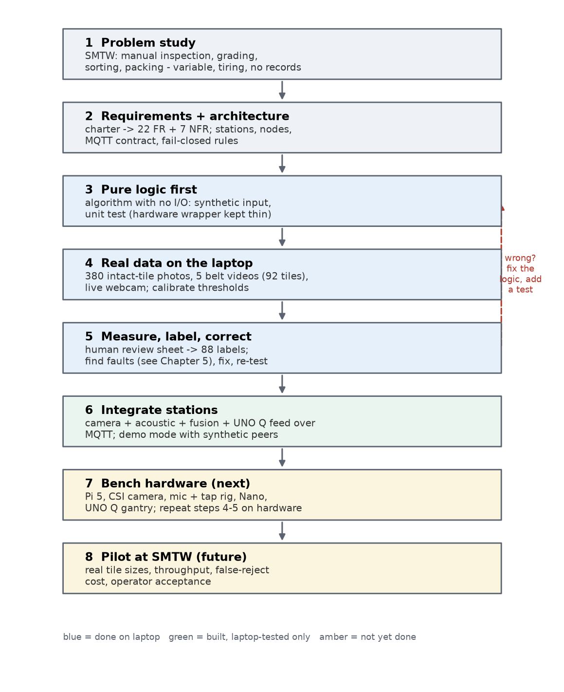

*Figure 4.1 — Method followed, from problem study to pilot. Blue: done on the laptop. Green: built, laptop-tested only.
Amber: not yet done.*

## 4.2 System architecture

Each inspection station is an independent node that processes its own raw data and publishes only a compact result. A
Raspberry Pi 5 runs two services (camera, and acoustic + decision) and the MQTT broker, so the line works with no master
PC. An Arduino Nano (planned) runs the striker release and belt; an Arduino UNO Q runs the gantry. The control LAN is an
isolated D-Link router with fixed addresses.

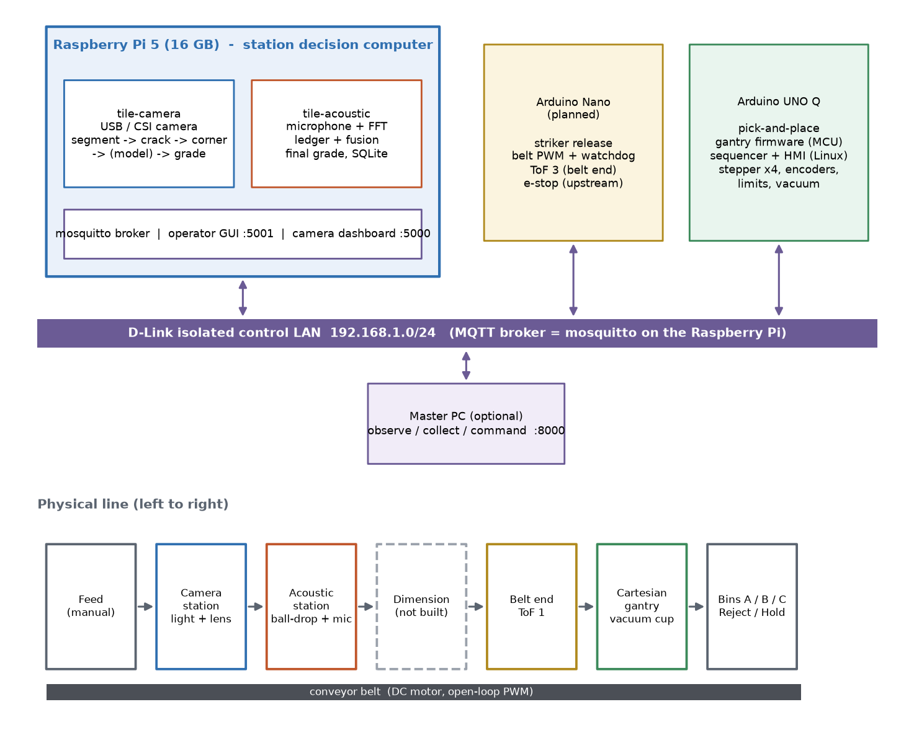

*Figure 4.2 — System architecture: nodes, control network and physical line. The dimensional station is dashed because it
is not built.*

## 4.3 Materials and equipment

| Item | Specification | Role | State |
|---|---|---|---|
| Raspberry Pi 5 | 16 GB RAM, Raspberry Pi OS Desktop 64-bit | Camera + acoustic + decision + broker | Not yet set up |
| Camera | 1080p USB webcam (laptop built-in used so far); CSI module planned | Visual station | Webcam used |
| Microphone | USB condenser (measurement mic planned) | Acoustic capture | Laptop mic only |
| Impactor | Ball drop, two solenoids (ARM + LOCK), laser/ToF trigger | Repeatable tap | Designed, not built |
| Arduino UNO Q | STM32U585 MCU (Zephyr) + Linux MPU | Pick-and-place | Lab board; bench apps only |
| Arduino Nano | ATmega328P | Striker + belt PWM + watchdog | Planned |
| Stepper gantry | CNC Shield V3.10, 4 × TMC2208, 4 × 42HM48-1684 (NEMA 17), Mean Well LRS-150-12 | Cartesian axes | In hand, not driven by final firmware |
| Sensors (planned) | 3 × VL53L1X ToF, 4 × AS5600 encoders, TCA9548A I²C mux | Presence, closed-loop axes | Planned; address clash found (§5.6). Bench 2026-10-18: mux and two Y encoders read on the UNO Q (A4/A5 = `Wire2`); no motor test yet |
| Network | D-Link DIR-825, isolated 192.168.1.0/24, no uplink | Control LAN | Plan written, partly set up |
| Belt / vision rig | Lab conveyor with green/teal mat; room light | Test belt | Used for the five videos |
| Tiles | 9 × 9 in terracotta; ~380 intact photos; 5 belt videos incl. real broken tiles | Data | Available |

*Table 4.1 — Hardware and equipment.*

| Layer | Software |
|---|---|
| Language / tests | Python 3.13; pytest (734 tests) |
| Vision | OpenCV, NumPy; optional ONNX Runtime |
| Acoustic | NumPy / SciPy, sounddevice |
| Web / GUI | Flask (station :5001, camera :5000, master :8000), Three.js twin |
| Messaging / storage | MQTT (mosquitto, paho-mqtt), SQLite |
| Models trained | Ultralytics YOLO26-cls, HF ViT-base → ONNX |

*Table 4.2 — Software stack.*

## 4.4 Camera station

### 4.4.1 Pipeline

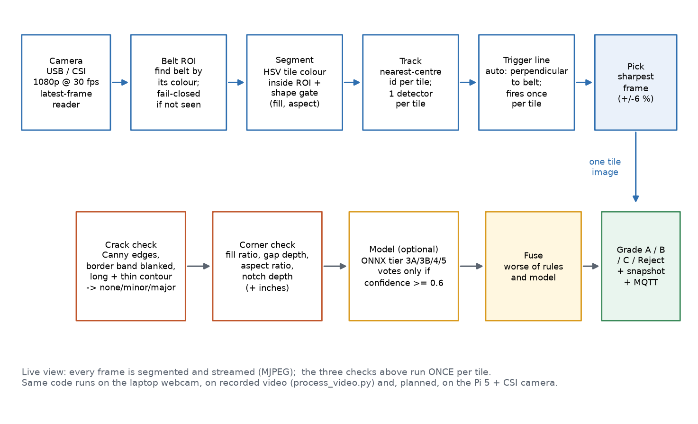

*Figure 4.3 — Camera pipeline. The live stream is segmented every frame; the three defect checks run once per tile.*

1. **Belt region.** The belt is located by its own colour each frame; everything outside it is blanked before tile
   matching, because the wooden bench has the tile's hue. If the belt cannot be seen, the answer is *no tile* — it fails
   closed rather than searching the whole frame.
2. **Segmentation.** HSV threshold inside the belt, then a **shape gate** (fill ratio ≥ 0.6 of the rotated bounding
   rectangle, aspect 0.5–2.0) so a sandal or a shadow is not graded. The gate is looser than the corner check on purpose, so
   a chipped tile is still *found* and then flagged.
3. **Identity.** Nearest-centre tracking gives every region its own id; one line-crossing detector per tile lets two
   tiles share the frame without being confused.
4. **Trigger.** A line perpendicular to the belt, learned automatically from the belt's principal axis, fires once per
   tile. Within ±6 % of the line, the **sharpest** frame (95th percentile of the edge gradient along the belt, in a thin
   band around the outline) is the one graded.

### 4.4.2 Measurements

*Crack:* Gaussian blur → Canny [12] → blank a border band (so the tile's own edge is not a "crack") → keep contours that
are long **and** thin → length from the minimum-area rectangle → severity minor / major.

*Corner:* three independent shape checks OR-ed together, from the tile contour $C$ and its minimum-area rectangle $R$:

$$\rho = \frac{A_c}{A_r} \qquad e = \frac{d_{max}}{s} \qquad a = \frac{\max(w,h)}{\min(w,h)}$$

A corner is flagged when $\rho < 0.86$, or $e > 0.22$, or $a > 1.15$ (a snapped tile is no longer square), or the
deepest convexity defect exceeds 8 % of the side. $d_{max}$ comes from a distance transform [14]; real missing area and
depth in inches use the tile's own detected pixel size and its known 9 in side, so no separate calibration target is needed.

*Why two checks:* $\rho$ alone under-reports a diagonal chip — a triangular chip removes much less area than a square
notch reaching the same depth. $e$ catches it.

### 4.4.3 Model as a second opinion

An optional ONNX classifier predicts a cosmetic tier (3A / 3B / 4 / 5). It **cannot see cracks or corners**, so it is
mapped onto the same scale (3A→A, 3B→B, 4→C, 5→Reject) and votes only above 0.6 confidence, and only to *lower* a grade.

### 4.4.4 Calibration from labels

Thresholds were first derived from ~380 intact-tile photos (a false-positive floor only), then refined from human
verdicts: a review sheet shows borderline tiles, a person marks each *fine / chipped / cracked / both / unsure*, and a
script prints threshold advice. It prints, it never edits the configuration — the operating point is a business decision.

| Setting | Value | Why |
|---|---|---|
| Resolution / rate | 1920 × 1080 @ 30 fps, MJPG | Webcam delivers 30 fps at every size; the old 640 × 480 @ 15 wasted it |
| Belt hue | 45–95 (teal ~86–93, green ~60–75) | Two different belts in the footage |
| Tile hue floor | 3 | A red colour cast cost an intact tile its grade at 6 |
| Corner fill / extent | 0.86 / 0.22 | Operating point from labels (§5.3, Fig. 5.8) |
| Model vote | ≥ 0.6 confidence | Below it the model abstains |

*Table 4.3 — Camera configuration values that matter.*

## 4.5 Acoustic station

**Impact.** A laser/ToF sensor detects the tile; two solenoids in sequence (ARM holds one ball, LOCK releases it) let a
ball fall under gravity, so impact energy is set by mass and height and no actuator touches the tile. The state machine
is shown in Figure 4.7; the pure-Python FSM `TapSequencer` mirrors the microcontroller sketch and is unit-tested.

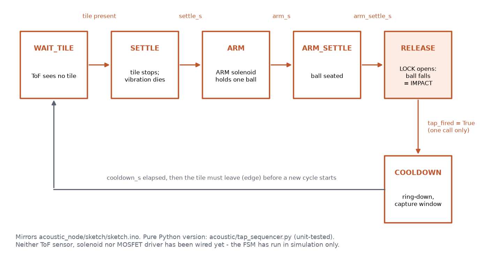

*Figure 4.7 — Tap sequencer state machine.*

**Prototype build (decided 2026-10-19).** The prototype simplifies two things. The belt is turned by hand, with no motor, so
tile timing is not repeatable and nothing from hand-turned runs should be used to calibrate belt timing. The impactor is a
single solenoid striker mounted directly above the tile: energising the solenoid retracts the striker against a spring, and
releasing it lets gravity and the spring drive the striker onto the tile. There is no ARM/LOCK interlock and no ball. The
strike can be started by the ToF sensor or by a manual command sent from the Pi to the Nano. The retraction itself makes a
noise that the microphone also records; it has to be removed from the analysed clip, for example by analysing only after the
release edge with a settle gap before it. This is not yet tested on the rig, striker mass, spring rate and drop height are
not measured, and `TapSequencer` and the UNO Q `sketch.ino` have not been changed for this configuration (the Nano core has: see below).
Source: `documents/project/project_charter.md` §6.2 "Prototype Configuration".

**Data collection (2026-10-19).** For the first dataset the station can record a *session*: one folder holding the continuous microphone, the camera's raw video with a frame-time log, every message the station sent with a timestamp, and each striker event labelled by the operator. Because energising the coil is a sound of its own, the retraction and the strike are recorded as two separate labelled events, so the retraction noise is available both as something to remove and as training data. Clips are cut from the continuous audio after the run (so the window can be changed later) and a manifest stores the SHA-256 of every file. This was tested only with a synthetic microphone and in-memory message bus on the development laptop (`tests/test_session_bag.py`, `tests/test_nano_sprung_striker.py`); it has not run on the Pi, with the real microphone or camera, or on a Nano, and the time alignment between audio, video and events is not measured. Source: `documents/programming/data_collection_sessions.md`.

**Measurement.** The clip is captured with a pre-trigger buffer, Hann-windowed, and reduced to peak frequency $f_p$, spectral
centroid, SNR and decay time $T_{20}$ from the Schroeder integral [18]:

$$E(t) = \int_t^{\infty} p^2(\tau)\,d\tau \qquad f_p = \arg\max_{f \ge 20\,\text{Hz}} |X(f)|$$

An intact tile is expected to ring higher and longer; a cracked one lower and shorter with extra low-frequency content.
Figure 4.8 *illustrates* this with **synthetic** signals produced by the project's own analysis functions.

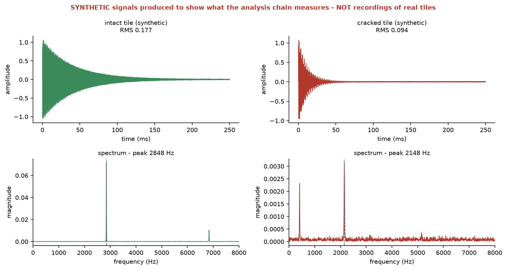

*Figure 4.8 — Synthetic tap signals and the features measured. These are generated, not recordings of real tiles.*

A separate desktop application (*Acoustic-Analysis*, its own repository, 237 tests) provides the full DSP suite, a guided
collection screen that removes motor and striker noise from every strike, a video "slice" tool that cuts a tap-test
video into labelled snippets, and a labelled-dataset export. It has run only on generated signals.

## 4.6 Decision and fusion

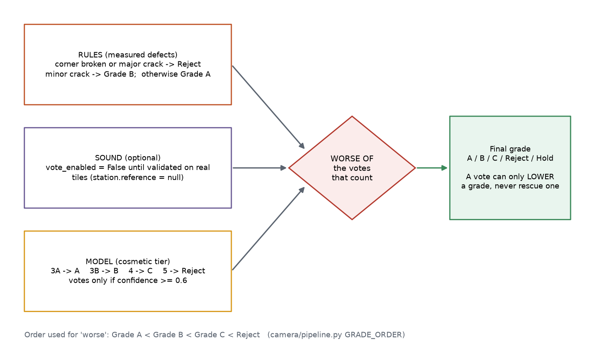

*Figure 4.4 — Grade fusion: the worse of the votes that count.*

$$G_{final} = \max_{i \in V}\ \operatorname{rank}(G_i),\qquad V=\{\text{rules}\}\cup\{\text{model if conf}\ge0.6\}\cup\{\text{sound if counted}\}$$

A vote can lower a grade and can never rescue one. The sound vote is **off by default** until a reference profile is
validated on real tiles; the sound result is stored and shown as "not counted".

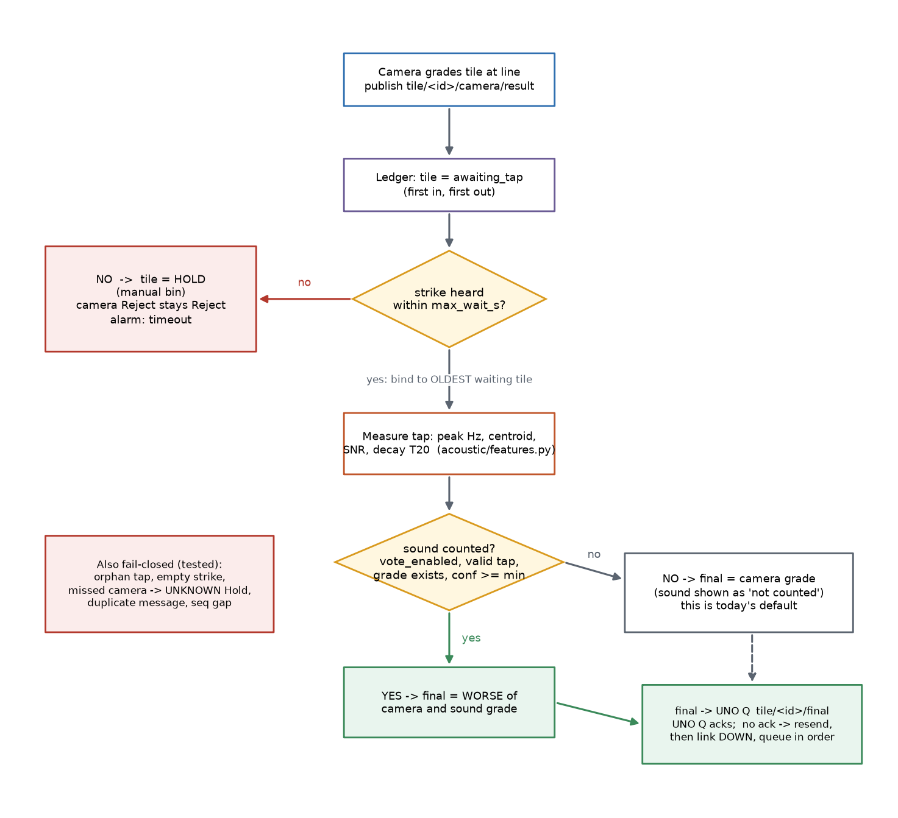

*Figure 4.5 — Per-tile decision flow with fail-closed branches.*

Tiles are bound to taps **by order**, not by time, because belt speed is open-loop (a tap binds to the *oldest* waiting
tile). Because order can silently shift by one if a detection is missed, the Nano reports whether a tile was under the
striker, and every anomaly is an explicit, tested rule:

| Situation | Result |
|---|---|
| No tap within `max_wait_s` | tile = **Hold**; a camera Reject stays Reject; alarm |
| Tap with no tile waiting | counted as orphan, alarmed, attached to nothing |
| Camera message unreadable | tile keeps its place, grade none → Hold |
| Same camera message twice (QoS 1) | ignored — one slot only |
| Strike on an empty position | uses no slot; alarm |
| Tile under striker, no camera result | `UNKNOWN-…` Hold final sent so the gantry's queue stays in step |
| Gap in strike sequence number | alarm with number of lost events |
| UNO Q does not acknowledge | resend; after retries link DOWN, finals queue in order |
| Broker down / camera silent / mic dead | station FAULT, red health chip, no guessing |

*Table 4.4 — Fail-closed rules (each is covered by a test).*

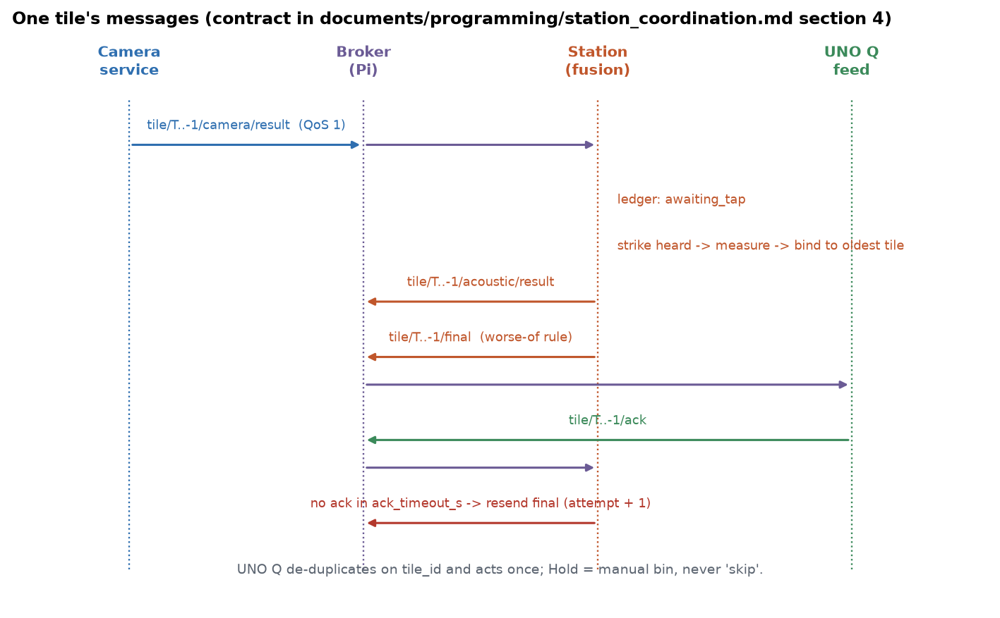

*Figure 4.6 — Messages exchanged for one tile.*

| Topic | Direction | QoS | Purpose |
|---|---|---|---|
| `tile/<id>/camera/result` | camera → station | 1 | grade + measurements |
| `station/tap` | Nano bridge → station | 1 | "striker fired", `tile_present` |
| `tile/<id>/acoustic/result` | station → master | 1 | sound features |
| `tile/<id>/final` | station → UNO Q | 1 | final grade + destination |
| `tile/<id>/ack` | UNO Q → station | 1 | acceptance (de-duplicated on id) |
| `station/status`, `station/camera/status` | each → all | 0, retained, last-will | health |

*Table 4.5 — MQTT topics (full contract in `documents/programming/station_coordination.md`).*

**Start-up.** The line comes up *holding* every tile; the belt starts only when the station, the camera and the gantry
feed have each answered a diagnostic ping through the broker. This is start-up sequencing, not clock synchronisation.

## 4.7 Pick and place

A three-logical-axis Cartesian gantry (the Y beam is two motors, cloned in hardware) with a vacuum-cup end effector. The
Linux side owns the coordinate model, the sequencer and the HMI; the MCU runs minimal firmware; a line-based ASCII
protocol with checksums joins them. A digital twin (Three.js in the browser, matplotlib on the desktop) and a simulated
MCU allowed the sequencer and a job runner to be tested without motion hardware. The UNO Q-side queue (`FinalQueue`,
`FeedClient`) is first-in-first-out, de-duplicating and acknowledging, and applies back-pressure by not acknowledging
when full. The firmware that moves real axes does not exist yet.

## 4.8 Verification method

- **Unit tests** for every pure module with synthetic input (734 tests; Figure 5.10).
- **Real footage**: five videos, 92 graded tiles; every graded tile exported as a lossless crop plus context picture.
- **Human labels**: 88 tiles labelled *fine / chipped / cracked / both* by eye (4 more "unsure").
- **Measured, not assumed**: belt speed, exposure, frame rate and per-stage time were measured on the actual webcam.
- **Confidence intervals** (Wilson) on every proportion, because the samples are small:

$$\hat p \;\pm\; \frac{z\sqrt{\hat p(1-\hat p)/n + z^2/4n^2}}{1+z^2/n},\qquad z=1.96$$

---

# CHAPTER 5 — RESULTS AND DISCUSSION

## 5.1 What works, and where it has been run

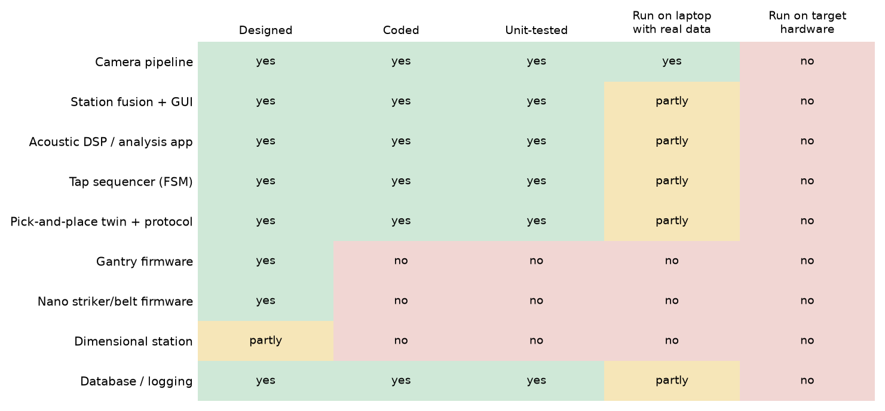

*Figure 5.1 — Readiness matrix. "Run on laptop": camera with real data; the others with synthetic input. Nothing has
run on its target hardware.*

| Part | Verified | Not verified |
|---|---|---|
| Camera pipeline | Webcam 1080p @ 30 fps; 5 belt videos / 92 tiles; tracking, trigger line, dashboard, record/replay | Pi 5, CSI camera; crack/corner accuracy not yet good (§5.3) |
| Station fusion + GUI | Ledger, fusion, SQLite, coordinator over an in-memory bus; GUI rendered against a synthetic demo; failure paths | A real broker, real microphone with real tiles, systemd units |
| Acoustic analysis app | 237 tests on generated signals | Any real tile recording; calibration (levels relative, not dB SPL) |
| Tap sequencer | FSM and simulated trigger path | ToF, solenoids, MOSFET driver never wired |
| Pick-and-place | Protocol, coordinate model, sequencer, job runner, twin, simulated MCU | Firmware moving real axes; stepper library under Zephyr |
| Network | Plan; reservations for UNO Q and Pi made | Full config; NTP on isolated LAN unresolved |

*Table 5.1 — Status of each part (2026-10-12).*

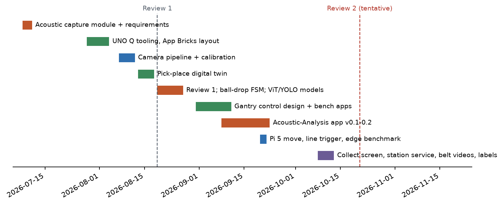

*Figure 5.9 — Development timeline from the logbook, against the two reviews.*

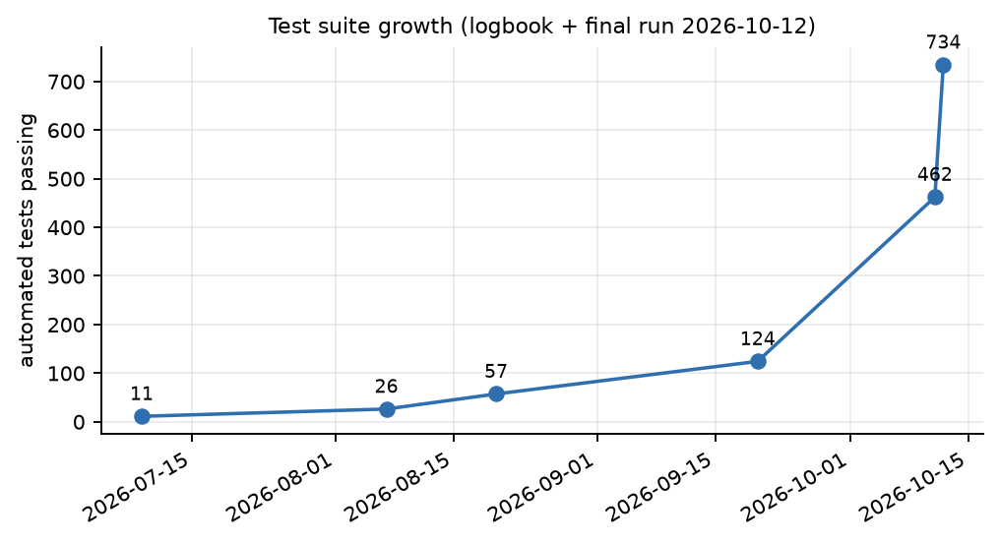

*Figure 5.10 — Automated tests passing, from the logbook and the final run on 2026-10-12.*

## 5.2 Behaviour on real belt footage

| Video | Resolution | Belt found | Tiles crossed |
|---|---|---|---|
| Phone clip (green belt) | 576 × 1024 | 100 % of 1715 frames | 7 |
| Webcam recording 12:16:03 | 1920 × 1080 | 100 % | 13 |
| Webcam recording 12:18:55 | 1920 × 1080 | 100 % | 30 |
| Webcam recording 12:25:11 | 1920 × 1080 | 100 % | 27 |
| Webcam recording 12:28:20 | 1920 × 1080 | 100 % | 15 |
| **Total** | | | **92** |

*Table 5.2 — Real belt footage processed (one config, no per-video overrides).*

All 92 crossings were in the forward direction, no tile crossed twice, gaps were steady at 1.3–3.9 s, and the line
orientation was learned as perpendicular to the belt in every video — including a portrait and a landscape camera.
Objects that used to be graded as tiles (a sandal beside the belt, the wooden bench, a person) no longer are.


*Figure 5.2 — A real frame from the 1080p webcam: belt region, tile contour and trigger line produced by the pipeline.*

## 5.3 Accuracy against human labels

Eighty-eight tiles were labelled by eye and four marked "unsure". The pipeline's grade at export time was compared with
the human verdict (damaged = chipped, cracked or both).

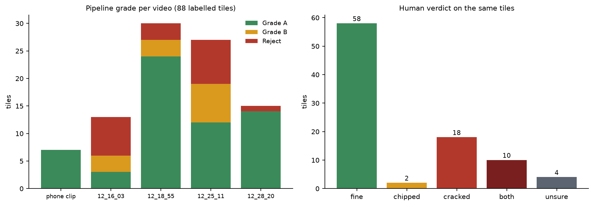

*Figure 5.3 — Pipeline grade per video, and the human verdict on the same tiles.*

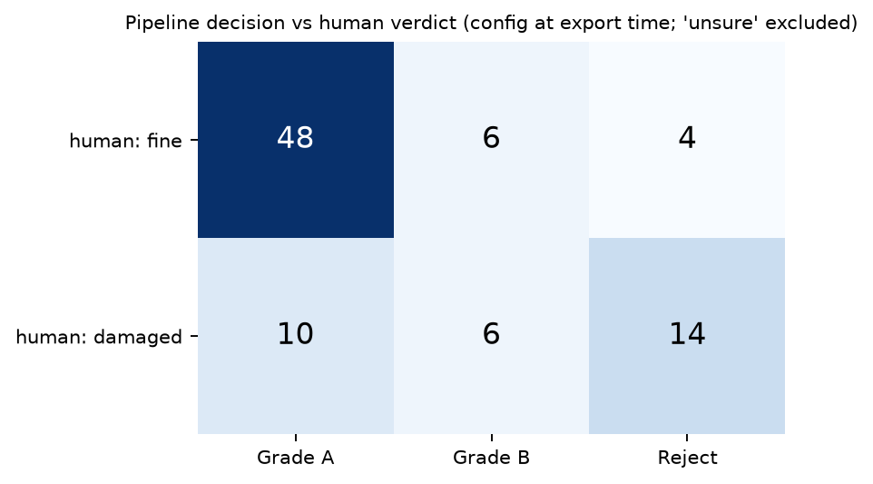

*Figure 5.4 — Pipeline decision against human verdict.*

| | Grade A | Grade B | Reject | Total | Rate (95 % CI) |
|---|---|---|---|---|---|
| Human: damaged | 10 | 6 | 14 | 30 | **Rejected 46.7 % (30–64)**; flagged B or worse 66.7 % (49–81) |
| Human: fine | 48 | 6 | 4 | 58 | **Wrongly rejected 6.9 % (2.7–16)**; wrongly downgraded 17.2 % (9.6–29) |

*Table 5.3 — Decision against human verdict (config at export time, 2026-10-11; 'unsure' excluded).*


*Figure 5.5 — Real tiles from the belt, with the human verdict and the pipeline's grade. Top row: correct. Bottom: a
chipped edge graded B, a cracked tile graded A, and a fine tile rejected.*

**Discussion.** Large damage is caught: snapped pieces and tiles with a corner gone are Rejected. What is *missed* is
mostly **hairline cracks** (nine of the eighteen "cracked" tiles were graded A) and small chips; what is *over-flagged* is
the crack check reading texture or the embossed back face of a tile as a crack. The camera sees about 1–3 px of a hairline
through ~7 px of motion smear (§5.4) — the limit here is the picture as much as the algorithm. After the two shape checks
added on 2026-10-12 (aspect ratio and notch depth) the project notes record 11 of 13 shape-damaged tiles caught (previously
6) with 2 of 58 fine tiles rejected (previously 0); **that run was not repeated for this report** and is a small sample on
one rig. The sample is small enough that the intervals are wide, and everything was measured on one rig with one camera.

## 5.4 Image quality, speed and the limits they set

| Stage | Time | Note |
|---|---|---|
| Belt region (colour mask) | ~13 ms / frame | dominant per-frame cost |
| Segmentation | ~8 ms / frame | |
| Whole per-frame pipeline | 24 ms (≈ 41 fps) at 1080p | dev laptop; Pi will be several times slower |
| Grade one tile | 1.7 ms | crack + corner |
| Offline replay | 16–22 fps | H.264 *decoding* was the limit, not the pipeline |

*Table 5.4 — Per-stage cost of the camera pipeline (dev laptop).*

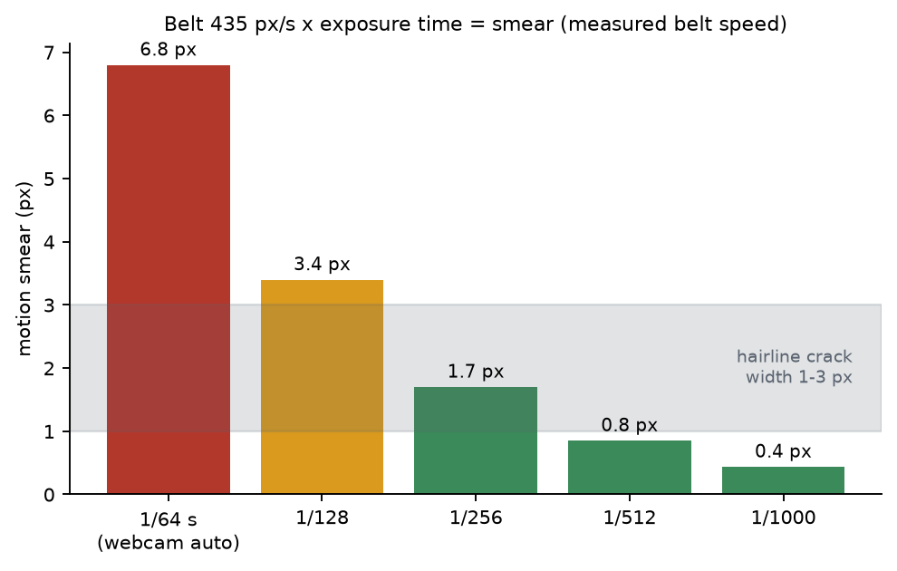

*Figure 5.6 — Motion smear from the measured belt speed (14.5 px/frame × 30 fps = 435 px/s). The webcam's automatic
exposure of 1/64 s smears a tile by about 7 px.*

$$b = v\,t_{exp} = 435 \times \tfrac{1}{64} \approx 6.8\ \text{px}$$

A 1–3 px hairline is erased. A faster shutter needs about eight times more light: at 1/128 s in room light the image was
nearly black (brightness 26/255) and the webcam driver rejects gain changes, so **the fix is lighting (or a slower belt),
not software**. Picking the sharpest of the frames near the line made the graded frame **1.30× sharper (median)**, sharper
for 91 % of tiles and blurrier for none, with the same 92 tiles counted.

## 5.5 Models

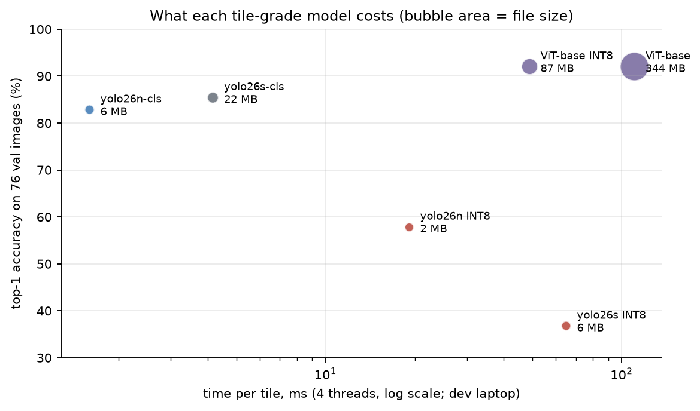

*Figure 5.7 — Accuracy against time per tile on the 76-image validation split, dev laptop, 4 threads.*

| Model | File | Accuracy (95 % CI) | Time / tile |
|---|---|---|---|
| yolo26n-cls | 6.2 MB | 82.9 % (72.9–89.7) | 1.59 ms |
| yolo26s-cls | 21.8 MB | 85.5 % (75.9–91.7) | 4.16 ms |
| ViT-base | 343.5 MB | 92.1 % (83.8–96.3) | 110.2 ms |
| ViT-base INT8 | 87.1 MB | 92.1 % (83.8–96.3) | 48.7 ms |
| yolo26n INT8 | 1.6 MB | 57.9 % | 19.1 ms |
| yolo26s INT8 | 5.6 MB | 36.8 % | 64.7 ms |

*Table 5.5 — Model accuracy and cost.*

Two results were not what was expected. Dynamic INT8 made the small YOLO models both **12× slower and much less
accurate** (82.9 → 57.9 %), while on the ViT it halved the time at no accuracy loss. And a preprocessing detail — OpenCV's
`INTER_LINEAR` versus Pillow's antialiased bilinear — cost **eight accuracy points** with no error raised; the deployed
path was verified byte-identical to the benchmark (max tensor difference 0.0, 100 % label agreement). On this project's
own camera the staged model reports about 30 % confidence, so under the 0.6 rule it abstains on every tile and the rules
decide alone; it must be retrained on station-camera tiles before it can contribute.

## 5.6 Faults found and how they were fixed

| # | Fault | How it was found | Effect | Fix and result |
|---|---|---|---|---|
| 1 | Tile identity flipped when two tiles shared the frame | Real belt footage through the line trigger | 12 crossings reported for 7 real tiles; 34.8 % of frames held two regions whose areas matched within 0.02 % | Track all regions with nearest-centre matching, one crossing detector each → 7 of 7, every capture just past the line |
| 2 | Crack check read the tile's own edge as a crack | Calibration on 311 intact photos | 98–100 % false positives | Blank a border band before contour matching → 2–11 % |
| 3 | Diagonal chips under-caught by area alone | Synthetic chip experiments | A chip reaching halfway across fell only to ρ ≈ 0.87, above the 0.83 limit | Second check on gap depth via distance transform |
| 4 | …but that fix was verified on a perfect square | Painting chips on a real tile | The same chip scored 2.4× lower on a real rotated tile; 4.5 in chip shipped as Grade A | Documented correction; aspect and notch-depth checks added; operating point made an explicit trade-off (Fig. 5.8) |
| 5 | Sandal and bench graded as tiles | Phone clip | Bogus Reject in the count | Shape gate + belt ROI; per-frame guard so one exception cannot stop inspection |
| 6 | Resize filter silently cost 8 points | Comparing `.onnx` against native weights | 82.9 → 75.0 % | Pillow bilinear + torchvision size arithmetic; verified identical |
| 7 | Scanning cameras killed the live feed | Real webcam | Recording froze at 3.5 s | Never open a camera that is streaming; scan skips the open one. Unit tests with fake cameras could not have caught it |
| 8 | Colour cast made an intact tile Reject | Real webcam video | Corner fill 0.60 | Tile hue floor 6 → 3; corner flags 13 → 10 over 92 tiles |
| 9 | Belt colour differs by camera (green vs teal) | New webcam videos | Belt found in 3/24 frames | Belt hue upper bound 95 |
| 10 | Two VL53L1X share I²C address 0x29 | I²C bus plan review | Would conflict at boot | XSHUT re-addressing + fail-safe belt stop (paper only) |

*Table 5.7 — Faults found and how they were fixed.*

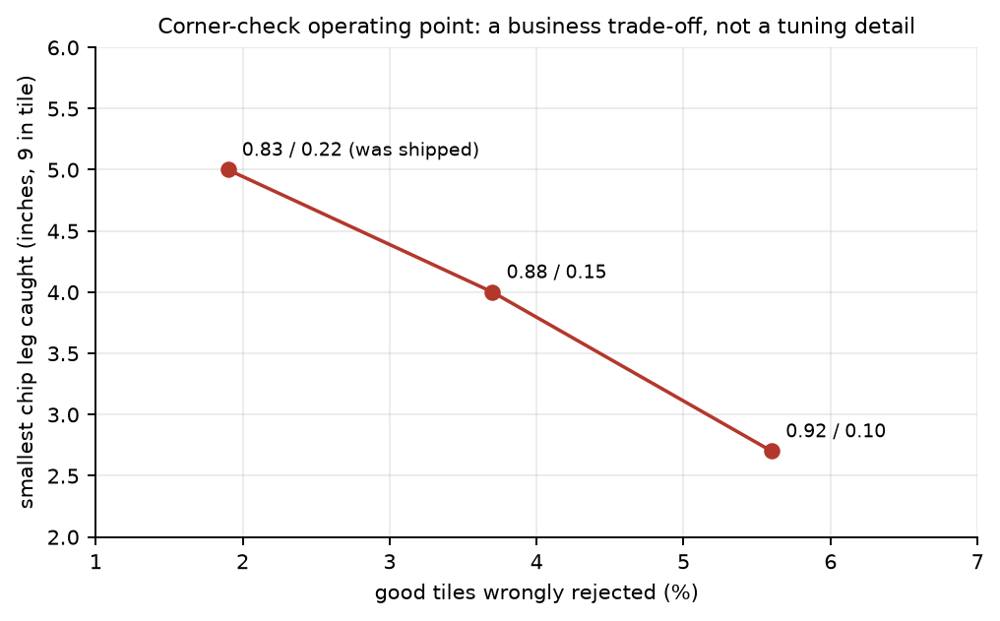

*Figure 5.8 — Corner-check operating point, measured on 378 intact photos with `development/corner_sensitivity.py`.*

Three lessons recur. *Test with the real thing early* (faults 1, 4, 7 appeared only on real footage or a real camera).
*A synthetic check can flatter the detector* (fault 4). *Silent failures are the dangerous ones* (6, 9, "zero tiles"), so
each is now either refused at start-up or shown on the dashboard.

## 5.7 Innovation and technical depth

**New in this work (and built):**
- An **ordered, acknowledged, fail-closed hand-off** between inspection and handling, with every failure branch tested.
- **Automatic trigger-line orientation** from the belt's principal axis, and **sharpest-frame picking** with a metric
  chosen by experiment (it fell monotonically from 1.00 to 0.50 on frames blurred 0–30 px, where Laplacian variance was
  flat and non-monotonic).
- **Measurement in real units** from the tile's own known size, with no calibration target in the picture.
- A **human-in-the-loop calibration** workflow so thresholds come from the line's own labelled footage.
- A **repeatable, non-contact impact** design (dual-solenoid gravity ball drop).

**Built since Review 1, laptop-only:** the first novelty item, the AI-assisted fault layer, now exists as the master's *AI
insights* page. Rule-based checks (`master/insights.py`, `integrity.py`) decide what changed; a local language model
(Ollama, `llama3.2:3b`) only *explains* it, when a person presses a button, and receives a whitelisted summary, never
tile rows. It was run on 2026-10-16/17 on synthetic data with one planted fault at a time: each of the seven fault kinds was
detected on its own page and nothing else fired (Figures 5.11-5.17). Model timing on this laptop (RTX 1000 Ada, 6 GB): 56 s
for the first call (model load), 8-16 s afterwards, 100 % on the GPU (`ollama ps`). **What this does not show:** it has
never seen real line data; the numbers are invented; the 3B model's explanations are readable but partly guessed (for
example it names a gantry fault or "taps not responding" where the findings state no cause, and one earlier run
invented a camera-heartbeat line), so every answer carries the label "AI-generated ... can be wrong". It cannot say *why*
something changed, and a line that was always bad reads as normal.

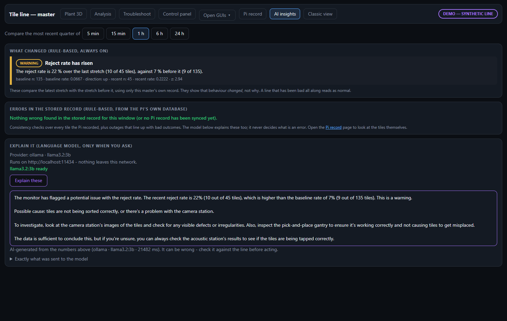

*Figure 5.11 — Reject rate has risen. Reject rate 22 % lately (10 of 45) against 7 % before (9 of 135); synthetic data, local model's explanation shown.*

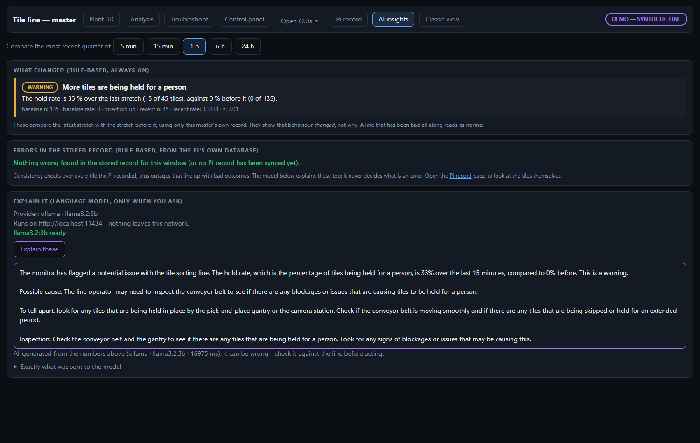

*Figure 5.12 — More tiles are being held for a person. Hold rate 33 % (15 of 45) against 0 % (0 of 135); synthetic data, local model's explanation shown.*

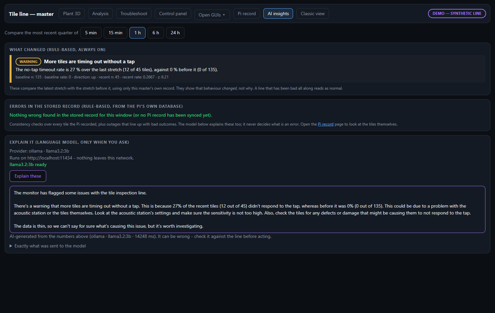

*Figure 5.13 — More tiles are timing out without a tap. No-tap timeout rate 27 % (12 of 45) against 0 % (0 of 135); synthetic data, local model's explanation shown.*

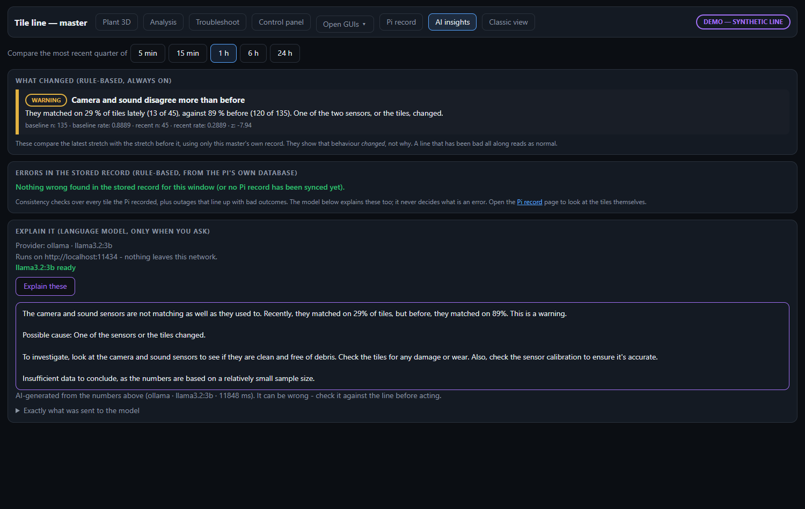

*Figure 5.14 — Camera and sound disagree more than before. Agreement 29 % (13 of 45) against 89 % (120 of 135); synthetic data, local model's explanation shown.*

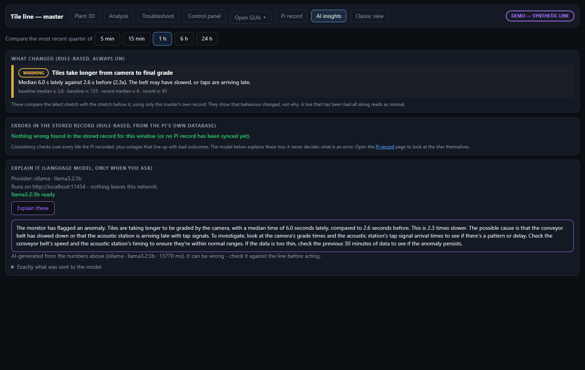

*Figure 5.15 — Tiles take longer from camera to final grade. Median 6.0 s against 2.6 s (2.3x); synthetic data, local model's explanation shown.*

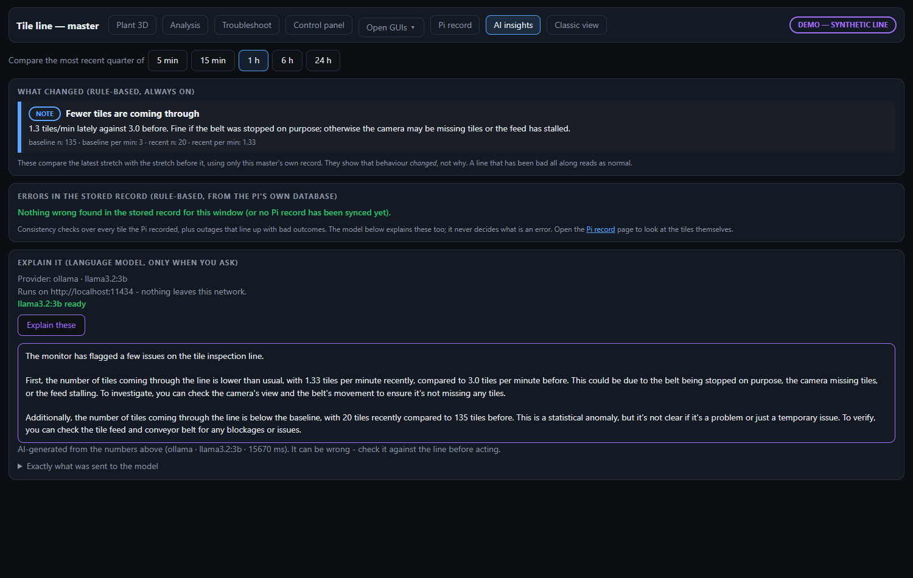

*Figure 5.16 — Fewer tiles are coming through. 1.3 tiles/min against 3.0 tiles/min; synthetic data, local model's explanation shown.*

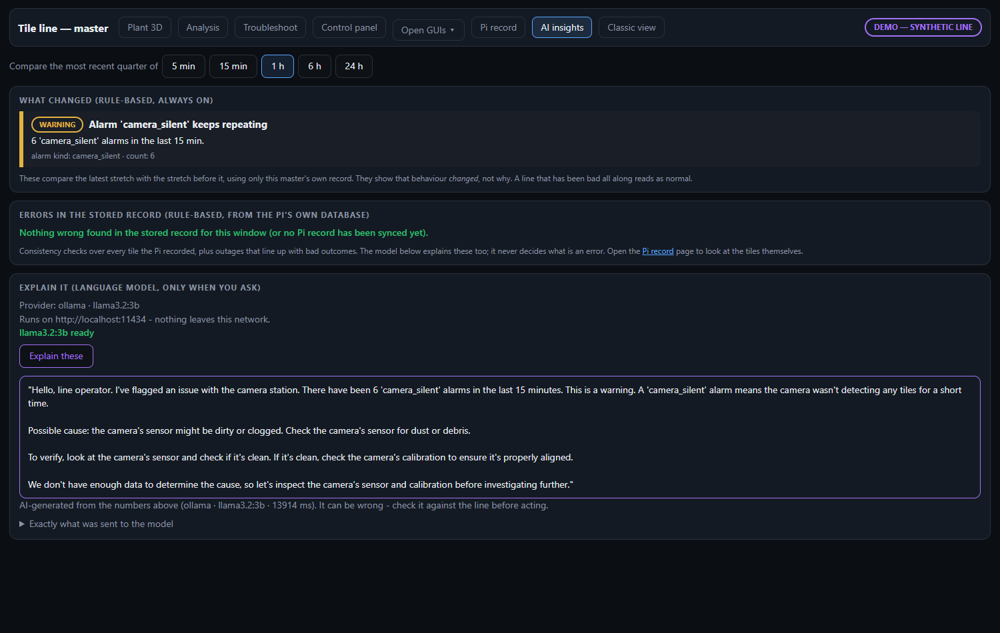

*Figure 5.17 — Alarm 'camera_silent' keeps repeating. 6 'camera_silent' alarms in 15 min; synthetic data, local model's explanation shown.*

**Proposed but not built** (reported as future work, not as results): adaptive grading that learns from operator
corrections. **Not original:** the individual techniques
(Canny, distance transform, FFT, MQTT, YOLO/ViT) are standard; the contribution is their assembly, the fail-safe
protocol, and the measurement discipline.

**Optimisation done:** latest-frame capture thread so a slow frame does not queue; downscaled MJPEG for the browser while
detection uses full resolution; INT8 evaluated and *rejected* for the small models on evidence; model preprocessing
verified identical to the benchmark.

## 5.8 Cost-benefit, environmental and societal impact

**Prototype cost.** The component list below follows the build. Prices are intentionally blank: they must come from
invoices or quotations, not from memory.

| Group | Items | Qty | Unit price (₹) | Source |
|---|---|---|---|---|
| Compute | Raspberry Pi 5 16 GB + cooler + PSU + SD | 1 | *(enter)* | |
| | Arduino UNO Q | 1 | *(enter)* | |
| | Arduino Nano | 1 | *(enter)* | |
| Sensing | USB camera / CSI module, light panel, USB microphone | 1 each | *(enter)* | |
| | VL53L1X ToF, AS5600 encoder, TCA9548A | 3 / 4 / 1 | *(enter)* | |
| Motion | NEMA 17 (42HM48-1684), TMC2208, CNC shield V3.10, LRS-150-12 | 4 / 4 / 1 / 1 | *(enter)* | |
| Actuation | Solenoids (ARM + LOCK), MOSFET driver, vacuum pump/cup, belt motor | | *(enter)* | |
| Mechanical | Aluminium frame, conveyor belt, gantry rails, bins | | *(enter)* | |
| Network | D-Link DIR-825 | 1 | *(enter)* | |
| **Total** | | | ***(sum)*** | |

*Table 5.6 — Prototype bill of materials.*

**Benefit model** (to be filled with SMTW data):

$$\text{annual benefit} = N\,[\,c_{scrap}\,(r_{fr}^{manual}-r_{fr}^{auto}) + c_{return}\,(r_{fa}^{manual}-r_{fa}^{auto})\,] + h\,w$$

with $N$ tiles per year, $c_{scrap}$ the value lost per good tile scrapped, $c_{return}$ the cost per defective tile
shipped, $r$ the false-reject / false-accept rates by method, and $h\,w$ the inspection labour hours saved times wage. The
automatic rates come from §5.3 — **currently not good enough to claim a benefit** (7 % good tiles wrongly rejected and
only 47 % of damaged tiles caught on one rig); the manual rates are unmeasured at SMTW. Payback is therefore *not*
stated. What would settle it: a labelled batch from SMTW through both the manual and automatic routes.

**Environment and society.** The expected environmental benefit is less fired clay scrapped and fewer defective tiles
shipped and returned (transport and re-firing energy); the expected social benefit is moving people from repetitive
inspection to handling exceptions. Both are *expected, not measured*. The hardware is low-power commodity electronics and
the software is open and runs on a single-board computer, which keeps the system affordable for a small works — the
route to wider adoption in similar clay and ceramic units.

---

# CHAPTER 6 — CONCLUSION

## 6.1 Achievements against the objectives

- **Objective 1 — visible defects (met in part).** A camera pipeline runs on real belt footage: it counts every tile once,
  grades it at a consistent point, and measures cracks and corners. Large damage is caught; hairline cracks are missed and
  about 7 % of good tiles are wrongly rejected, so the crack check is being recalibrated from labels.
- **Objective 2 — hidden defects (not yet met).** The impact mechanism, sequencer, capture window and analysis chain are
  designed, coded and unit-tested, but no real tile has been tapped on the rig.
- **Objective 3 — fusion and safe failure (met in software).** A single grade, an ordered ledger and every failure branch
  are tested; it has not run against a live broker or the Pi.
- **Objective 4 — sorting and logging (partly met).** Final grades are delivered, acknowledged and recorded in software;
  the gantry firmware that moves real axes does not exist yet.

## 6.2 Scalability

The architecture is already per-station and message-based: adding a station adds a publisher, adding a line adds a Pi.
Camera and decision run on a single inexpensive computer; the final-grade contract does not depend on what is behind it,
so a different handler (pushers, diverters) can replace the gantry. The same pipeline applies to other flat ceramic
products (floor tiles, roof tiles, plates) by changing size, colour range and the corner/shape rules.

## 6.3 Technical hurdles

1. **Identity of two tiles in one frame (Fault 1).** Reported 12 crossings for 7 tiles. Found only on real footage; solved
   by tracking every region instead of the largest one; verified 7 of 7.
2. **A detector that looked right on synthetic input (Faults 3–4).** The corner fix passed on a perfect square and
   under-performed on a real tile by 2.4×. Re-measured on real photos, documented, extended with two more shape checks,
   and the operating point exposed as an explicit trade-off.

Further hurdles are in Table 5.7 (resize filter, camera scan, colour cast).

## 6.4 Future work

1. **Ground truth first:** label every belt tile (the labelling mode is built) and recalibrate crack/corner from labels.
2. **Light the belt** (about 8×) or slow it; then re-measure hairline detection.
3. **Bring up the hardware:** image the Pi 5, run the installer, measure fps at 1080p; wire the ToF and solenoids; first
   real taps; repeatability and good-vs-defective separation; then switch on the sound vote.
4. **Closed-loop belt speed** (encoder) so transit time is a number, replacing the placeholder `max_wait_s`.
5. **Gantry firmware** on the UNO Q, with the stepper library question answered under Zephyr.
6. **Dimensional check** from the camera (width, height, squareness) to meet FR-06.
7. **Pilot at SMTW:** real tile sizes and throughput, manual-vs-automatic comparison, cost model filled in.
8. **Software novelty:** the LLM fault explainer is built (laptop-only) and needs a trial on real line data and a better prompt or model; adaptive grading from operator corrections is not built.

---

# REFERENCES

*Journal and conference papers (details verified from the publisher page unless marked †):*

1. Panyavaraporn, J., Limsupreeyarat, P. and Horkaew, P. (2020), 'DWT/MFCC feature extraction for tile tapping sound
   classification', *International Journal of Integrated Engineering* 12 (3), 122–130.
2. Cunha, R., Maciel, R., Nandi, G. S., Daros, M. R., Cardoso, J. P., Francis, L. T., Ramos, V. F. C., Marcelino, R.,
   Fröhlich, A. A. and de Araujo, G. M. (2018), 'Applying non-destructive testing and machine learning to control of
   quality of ceramic tiles', in *Proc. 8th Simpósio Brasileiro de Engenharia de Sistemas Computacionais (SBESC)*,
   Salvador, pp. 66–73.
3. Maungmeesri, B., Khonthon, S., Maneetham, D. and Crisnapati, P. N., 'Efficient YOLO-based models for real-time ceramic
   crack detection', *IAES International Journal of Artificial Intelligence* 15 (1), 852–860,
   doi:10.11591/ijai.v15.i1.pp852-860.
4. † 'Review of research on ceramic surface defect detection based on deep learning' (2025), *Electronics* 14 (12), 2365.
   *(authors to be added)*
5. † 'MCAW-YOLO: lightweight ceramic tile defect detection' (2023), *Applied Sciences* 13 (21), 12057.
   *(exact title and authors to be added)*
6. † 'CTDD-YOLO' lightweight tile defect detection (2024), *Electronics* 13, article 3931. *(exact title and authors to be
   added)*
7. † Zhou et al. (2023), 'Progress in deep learning for surface defect detection of ceramics', *Journal of the Chinese
   Ceramic Society* 44 (5), 874–884.
8. † Jiang, Luk and Liu (2009), impact-acoustic detection of tile-wall bonding quality. *(venue and title to be confirmed)*
9. † Luk et al. (2010), *Journal of Sound and Vibration*, wavelet/SVM classification of impact-acoustic signals from tiled
   structures. *(title and volume to be confirmed)*
10. † Gantry robot with vision control for pick-and-place using Python/OpenCV and Arduino Mega (2025), *Al-Khwarizmi
    Engineering Journal* 21 (4). *(authors and title to be confirmed)*

*Foundational methods and standards:*

11. Otsu, N. (1979), 'A threshold selection method from gray-level histograms', *IEEE Transactions on Systems, Man, and
    Cybernetics* 9 (1), 62–66.
12. Canny, J. (1986), 'A computational approach to edge detection', *IEEE Transactions on Pattern Analysis and Machine
    Intelligence* 8 (6), 679–698.
13. Suzuki, S. and Abe, K. (1985), 'Topological structural analysis of digitized binary images by border following',
    *Computer Vision, Graphics, and Image Processing* 30 (1), 32–46.
14. Borgefors, G. (1986), 'Distance transformations in digital images', *Computer Vision, Graphics, and Image Processing*
    34 (3), 344–371.
15. Dosovitskiy, A. et al. (2021), 'An image is worth 16×16 words: transformers for image recognition at scale', in *Proc.
    ICLR*.
16. Redmon, J., Divvala, S., Girshick, R. and Farhadi, A. (2016), 'You only look once: unified, real-time object
    detection', in *Proc. IEEE CVPR*, pp. 779–788.
17. Harris, F. J. (1978), 'On the use of windows for harmonic analysis with the discrete Fourier transform', *Proceedings
    of the IEEE* 66 (1), 51–83.
18. Schroeder, M. R. (1965), 'New method of measuring reverberation time', *Journal of the Acoustical Society of America*
    37 (3), 409–412.
19. Cooley, J. W. and Tukey, J. W. (1965), 'An algorithm for the machine calculation of complex Fourier series',
    *Mathematics of Computation* 19 (90), 297–301.
20. Wilson, E. B. (1927), 'Probable inference, the law of succession, and statistical inference', *Journal of the American
    Statistical Association* 22 (158), 209–212.
21. OASIS (2014), *MQTT Version 3.1.1*, OASIS Standard.
22. United Nations (2015), *Transforming our world: the 2030 Agenda for Sustainable Development*, A/RES/70/1.
23. Bradski, G. (2000), 'The OpenCV library', *Dr. Dobb's Journal of Software Tools*.

*Web references:*

24. Arduino, *Arduino UNO Q* product documentation. Retrieved October 2026. *(URL and access date to be added)*
25. Raspberry Pi Ltd., *Raspberry Pi 5* product brief. Retrieved October 2026. *(URL and access date to be added)*

---

# APPENDIX A — DESIGN DATA AND CODE

### A.1 Repository layout

| Folder | Content |
|---|---|
| `camera_node/` | Vision pipeline, dashboard, Pi deployment (`deploy/`) |
| `acoustic_node/` | Acoustic module, `fusion/` (ledger, final grade, store, bus, coordinator), station service and GUI, UNO Q sketch |
| `pick_place_node/` | Protocol, coordinate model, sequencer, job runner, digital twin, bench apps |
| `master_node/` | Optional observer / collector / commander |
| `development/` | Calibration, review sheet, dataset export, corner trade-off, camera probe |
| `camera_models/` | Training (YOLO, ViT) and edge benchmark |
| `Acoustic-Analysis/` | Submodule: DSP suite and labelling app |
| `documents/` | Charter, architecture, requirements (22 FR + 7 NFR), protocols, wiring, this report |

### A.2 Requirements traceability (extract)

| ID | Requirement | Where addressed |
|---|---|---|
| FR-02 / FR-23 / FR-24 | Camera detects and *measures* cracks and corners after segmenting the tile | §4.4, §5.3 |
| FR-03 | Acoustic detects hidden cracks by controlled impact | §4.5 *(rig not run)* |
| FR-09 / FR-11 / FR-12 | Final grade, unique tile id, tracking by position not time | §4.6 |
| FR-10 | MQTT over a wired network | §4.6, Table 4.5 |
| FR-06 | Dimension from the camera (open) | §6.4 |
| FR-18 | No off-the-shelf G-code controller | §2.8, §4.7 |

### A.3 Reproducing the numbers and figures

```powershell
.venv\Scripts\activate
python documents\deliverables\review_2\figures\make_figures.py     # all figures
python -m pytest tests/ -q                                         # 734 tests (set OPENBLAS_NUM_THREADS=1 if it dies silently)
python development\corner_sensitivity.py                           # corner trade-off
python -m camera.process_video <video> --report report.json        # from camera_node\python
python -m acoustic.live_station --demo                             # station GUI, synthetic peers
```

### A.4 Key algorithm listings

The camera, fusion and tap-sequencer sources are in `camera_node/python/camera/` (`segmentation.py`, `belt_roi.py`,
`region_tracker.py`, `crack_detection.py`, `corner_detection.py`, `pipeline.py`), `acoustic_node/python/fusion/`
(`ledger.py`, `final_grade.py`, `coordinator.py`) and `acoustic_node/python/acoustic/tap_sequencer.py`. *Select the
excerpts the guide wants printed; do not paste whole files.*

# APPENDIX B — PLAGIARISM REPORT

*(Attach the institute's similarity report here once the report has been rewritten in the team's own words.)*
